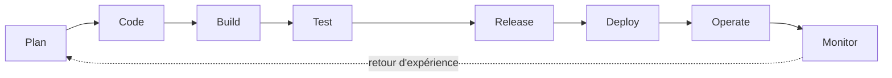

# Cycle de vie DevSecOps détaillé — Collector.shop

Ce document détaille, pour chaque étape du cycle de vie, les mesures de sécurité prévues dans le plan général, leur état réel dans le POC et les preuves associées.

Statuts utilisés :

- **Réalisé** : en place et vérifié.
- **Partiel** : en place en partie, écart documenté.
- **Non réalisé** : prévu, pas encore mis en œuvre. Repris dans le [plan de remédiation](06-plan-remediation-securite.md).

## 1. Vue d'ensemble

## 2. Détail par étape

### 2.1 Plan

| Mesure | Statut | Preuve ou écart |
|---|---|---|
| Modélisation des menaces (STRIDE simplifié) sur le flux « publication article » | Partiel | Le flux est décrit dans le plan général (vendeur, API, RabbitMQ, worker, résultat). La matrice STRIDE n'est pas rédigée. |
| Périmètre fonctionnel sécurisé : seul un vendeur publie | Réalisé | `@Roles('vendeur')` sur `POST /articles`, `RolesGuard`, identifiant vendeur = claim `sub` du JWT. |

### 2.2 Code

| Mesure | Statut | Preuve ou écart |
|---|---|---|
| Linting dans le pipeline | Réalisé | Workflow réutilisable `reusable-lint-test-scan-build.yml` appelé par les trois services. |
| SAST avec règles de sécurité ESLint | Partiel | Lint actif. Les règles de sécurité spécifiques ne sont pas démontrées dans ce POC. |
| Revue de code obligatoire via Pull Request | Réalisé | Une branche par étape, une PR par étape vers `main`, merge effectué après validation par le responsable du projet. |
| Conventions de commit | Réalisé | Format `type(scope): description`, un commit par tâche du backlog. |

### 2.3 Build

| Mesure | Statut | Preuve ou écart |
|---|---|---|
| Scan des dépendances (SCA) | Réalisé | `npm audit --omit=dev --audit-level=high` bloquant. Résultat actuel : 0 vulnérabilité sur les trois services. |
| Gestion des secrets : aucun secret en clair dans le dépôt | Réalisé | Fichiers `.env.example` seulement. Secrets de CI dans GitHub Actions (`SONAR_TOKEN`). |
| Secrets via HashiCorp Vault | Partiel | Vault est présent dans `docker-compose.yml`. Les charts Helm ne l'utilisent pas encore : les secrets runtime sont injectés autrement. |
| Image de base minimale et utilisateur non-root | Réalisé | Image `node:22-alpine`, `apk upgrade`, npm retiré de l'image d'exécution, `USER node`. |

### 2.4 Test

| Mesure | Statut | Preuve ou écart |
|---|---|---|
| Tests unitaires avec couverture | Réalisé | API : 22 tests, worker : 12 tests, frontend : 17 tests. Seuils Jest sur l'API. |
| Tests d'intégration | Réalisé | `articles.integration.spec.ts` : JWKS RSA local, vérification des 401 (sans token) et 403 (rôle acheteur). |
| Tests de non-régression sécurité | Réalisé | Cas couverts dans le test d'intégration : accès non authentifié refusé, rôle insuffisant refusé, vendeur autorisé. |
| Tests d'acceptation de bout en bout (Supertest sur le flux complet) | Partiel | Le flux est validé manuellement (API, RabbitMQ, worker, résultat). Il n'est pas encore automatisé dans la CI. |
| Test de charge | Réalisé | Script k6 `collector-infra/load-tests/articles.js`, seuils p95 par endpoint. Voir [indicateurs qualité](01-indicateurs-qualite-iso25010.md). |

### 2.5 Release

| Mesure | Statut | Preuve ou écart |
|---|---|---|
| Scan de l'image Docker (Trivy) | Réalisé | Trivy `CRITICAL,HIGH` en `exit-code 1`. Action épinglée par SHA (`v0.36.0`) après l'incident de supply chain de 2026. |
| Publication de l'image dans GHCR | Réalisé | `ghcr.io/leopoldpetit/collector-frontend`, `collector-catalog-api`, `collector-moderation-worker`. Tag = SHA du commit. |
| Signature des images | Non réalisé | Pas de signature (cosign) à ce stade. |
| Changelog | Non réalisé | Pas de fichier de changelog généré. Les messages de commit suivent la convention pour un futur changelog automatique. |

### 2.6 Deploy

| Mesure | Statut | Preuve ou écart |
|---|---|---|
| Déploiement Helm sur Minikube | Réalisé | Chart générique `collector-service` et values par service. |
| Images tirées de GHCR par tag immuable | Réalisé | `pullPolicy: IfNotPresent`, tag SHA. `imagePullSecrets` optionnel, les packages étant publics. |
| HTTPS / TLS | Partiel | Ingress NGINX exposé en HTTPS (`https://shop.localhost:8443`). Le `ClusterIssuer` cert-manager est fourni, mais les certificats Minikube sont auto-signés. |
| Network policies | Non réalisé | Aucune `NetworkPolicy` dans les charts. |
| Secrets injectés depuis Vault | Non réalisé | Voir 2.3. |

### 2.7 Operate

| Mesure | Statut | Preuve ou écart |
|---|---|---|
| Authentification et autorisation OIDC (Keycloak) | Réalisé | Realm `collector-shop`, client public `collector-frontend`, rôles `vendeur` et `acheteur`. JWT vérifié côté API via JWKS (`jose`). |
| Durée de vie des tokens | Réalisé | Access token de 300 secondes. |
| Rotation des secrets | Non réalisé | Pas de rotation automatisée. Dépend de l'intégration Vault. |
| Rate limiting sur l'API publique | Non réalisé | Aucun throttling dans l'API ni dans l'Ingress. |

### 2.8 Monitor

| Mesure | Statut | Preuve ou écart |
|---|---|---|
| Logs centralisés (Loki) | Réalisé | Logs des pods consultables dans Grafana. |
| Métriques (Prometheus) | Réalisé | Métriques de l'Ingress NGINX (`nginx_ingress_controller_requests`, statuts 200 et 404). |
| Dashboard Grafana | Réalisé | Datasources Loki et Prometheus, dashboard de base. |
| Alerting sur anomalies (pics de 5xx, échecs d'authentification) | Non réalisé | Pas de règle d'alerte démontrée. |

## 3. Synthèse

| Statut | Nombre de mesures |
|---|---|
| Réalisé | 20 |
| Partiel | 5 |
| Non réalisé | 7 |

Les écarts (Vault, network policies, rate limiting, alerting, signature d'images, rotation des secrets) sont priorisés dans le [plan de remédiation sécurité](06-plan-remediation-securite.md).
