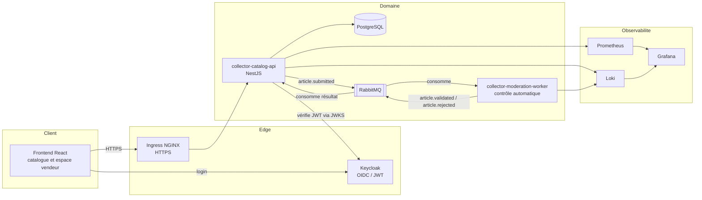
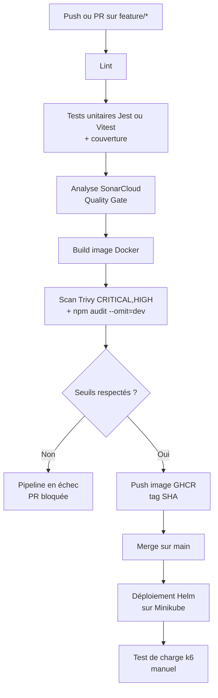

# Backlog, architecture et CI/CD — Collector.shop

Ce document présente l'état réel du backlog US1 à US9, l'architecture technique du POC et le pipeline CI/CD. Les schémas reflètent l'implémentation actuelle. Les écarts avec la cible du plan général sont signalés.

## 1. État du backlog

| # | User story | Statut | Réalisation | Repos |
|---|---|---|---|---|
| US1 | Connexion vendeur via Keycloak | Partiel | Connexion OIDC, redirection frontend, JWT vérifié par l'API. La création de compte en libre-service n'est pas implémentée : les comptes de démonstration sont préexistants dans le realm. | `collector-catalog-api`, `collector-frontend` |
| US2 | Publication d'article (statut `draft`, événement `article.submitted`) | Réalisé | `POST /articles` avec rôle `vendeur`, publication RabbitMQ persistante. | `collector-catalog-api` |
| US3 | Contrôle automatique par le worker | Réalisé | Consommation de `article.submitted`, règles pures, publication de `article.validated` ou `article.rejected` avec motif. 12 tests unitaires. | `collector-moderation-worker` |
| US4 | Mise à jour du statut après contrôle | Réalisé | Consommation de `moderation-results` par l'API, transition idempotente depuis `DRAFT` ou `PENDING`. Suivi du statut dans le frontend (interrogation de `GET /articles/:id`). | `collector-catalog-api`, `collector-frontend` |
| US5 | Catalogue public | Réalisé | `GET /articles?status=published` sans authentification, page catalogue du frontend. Validé dans le navigateur. | `collector-catalog-api`, `collector-frontend` |
| US6 | Pipeline CI/CD avec tests et scans | Partiel | Lint, tests, scan Trivy et `npm audit` bloquants pour les trois services. Seuil de couverture bloquant sur l'API uniquement ; le worker a un job SonarCloud non bloquant. | les trois services |
| US7 | Déploiement Minikube via Helm | Réalisé | Charts Helm, Ingress NGINX, accès HTTPS (`https://shop.localhost:8443`). | `collector-infra` |
| US8 | Observabilité | Réalisé | Grafana (datasources, dashboard), Loki pour les logs, Prometheus pour les métriques de l'Ingress. | `collector-infra` |
| US9 | Notification selon centres d'intérêt (stretch) | Hors périmètre | Documenté comme évolution. | `collector-catalog-api` |

Étapes d'exécution : Étapes 0 à 10 du backlog réalisées. Étape 9 : PR `collector-catalog-api` #10 et `collector-moderation-worker` #3 vérifiées par les checks. Étape 10 : PR `collector-infra` #16 ouverte (tests de charge et synthèse). Étape 11 : le présent dépôt.

## 2. Architecture technique

### 2.1 Stack

| Brique | Choix retenu | Remarque |
|---|---|---|
| API métier | NestJS, TypeScript, Prisma 5.22 | Conforme au plan |
| Base de données | PostgreSQL | Conforme au plan |
| Messagerie | RabbitMQ (files `moderation` et `moderation-results`, durables) | Conforme au plan |
| Worker | NestJS microservice RabbitMQ | Conforme au plan |
| Frontend | React, Vite | Conforme au plan |
| Authentification | Keycloak (OIDC, JWT, JWKS) | Conforme au plan |
| Secrets | Vault en docker-compose | Non connecté aux services, voir le plan de remédiation |
| Reverse proxy, TLS | Ingress NGINX, cert-manager (`ClusterIssuer`) | Le plan prévoyait Traefik ou Ingress NGINX : Ingress NGINX retenu |
| Observabilité | Prometheus, Grafana, Loki | Conforme au plan |
| Qualité | ESLint, SonarCloud, Jest | Conforme au plan |
| Scans | Trivy, `npm audit` | Conforme au plan |
| Tests de charge | k6 | Conforme au plan |

### 2.2 Schéma applicatif

### 2.3 Environnement d'exécution

- Cible : cluster Minikube local, un chart Helm générique `collector-service` avec un fichier de values par service.
- Images : GHCR, tag = SHA du commit, `pullPolicy: IfNotPresent`.
- Exposition : Ingress NGINX sur `api.localhost`, `shop.localhost`, `keycloak.localhost` et `grafana.localhost`.
- Le déploiement reste local. Les consignes n'exigent pas une préproduction complète.

## 3. Pipeline CI/CD

### 3.1 Pipeline par service (GitHub Actions)

Remarques :

- Le workflow est réutilisable : `collector-infra/.github/workflows/reusable-lint-test-scan-build.yml`, appelé avec `@main`.
- Le test de charge n'est pas dans le pipeline. Il est lancé manuellement, car il demande un cluster en fonctionnement.
- Le déploiement est une étape manuelle (`helm upgrade`) : il n'existe pas encore de job CD automatisé.

### 3.2 Tests du pipeline

| Type | Où | Volume |
|---|---|---|
| Unitaires | API, worker, frontend | 22, 12 et 17 tests |
| Intégration | API (JWKS local, accès protégé vs public) | Inclus dans les 22 tests de l'API |
| Acceptation, flux de publication | Validé manuellement sur le cluster | Pas encore automatisé |
| Charge | k6, `collector-infra/load-tests` | 9 173 requêtes, 0 % d'erreur |

## 4. Écarts à traiter

- Vault non connecté aux services.
- Pas de job CD automatisé.
- Flux de publication pas encore couvert par un test d'acceptation automatisé dans la CI.

Ces écarts sont repris dans le [plan de remédiation sécurité](06-plan-remediation-securite.md).
